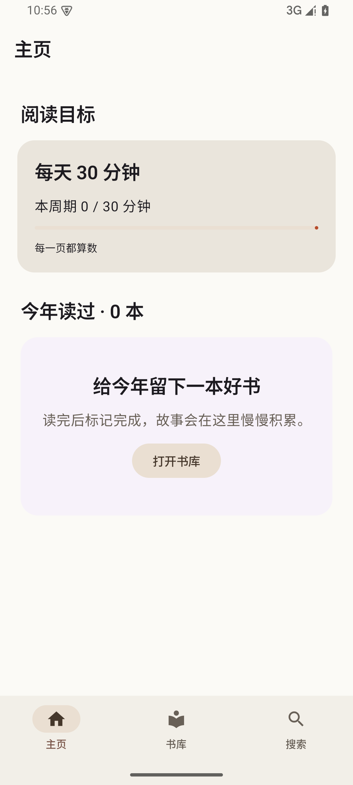
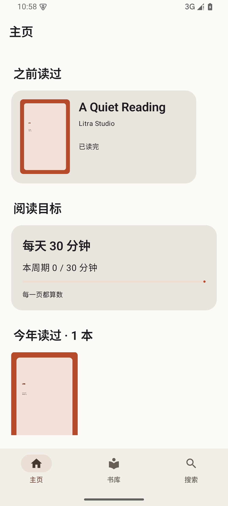
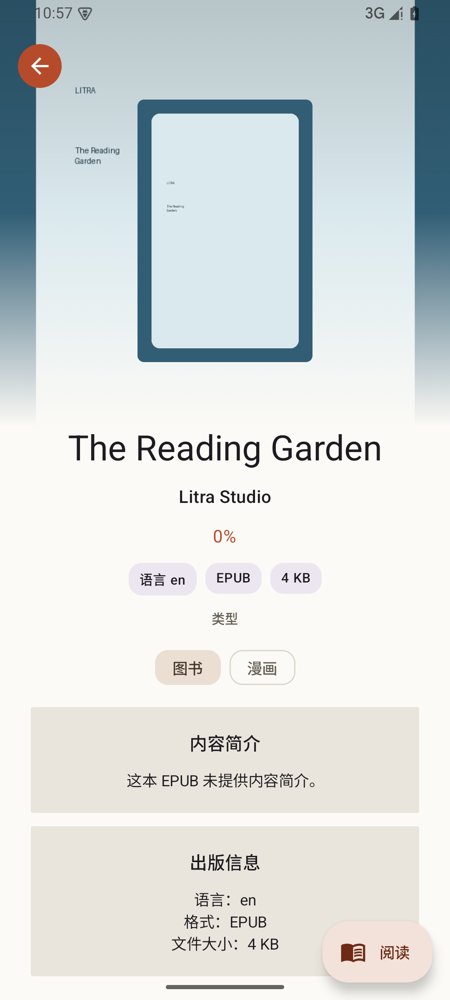
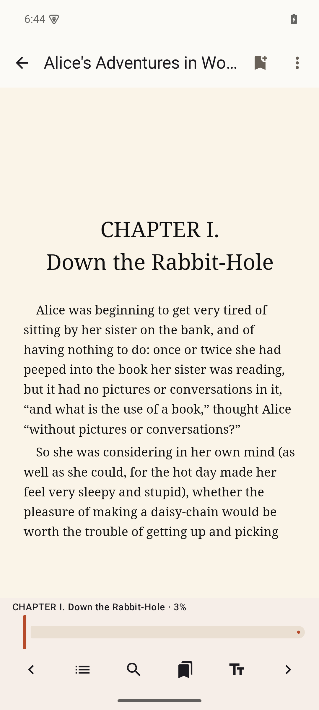
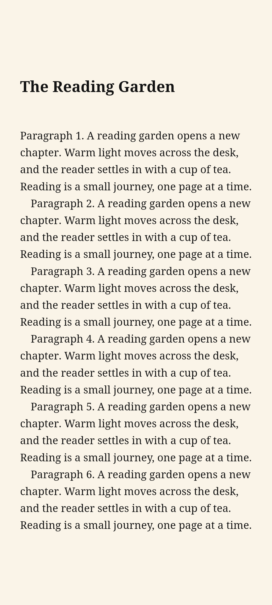
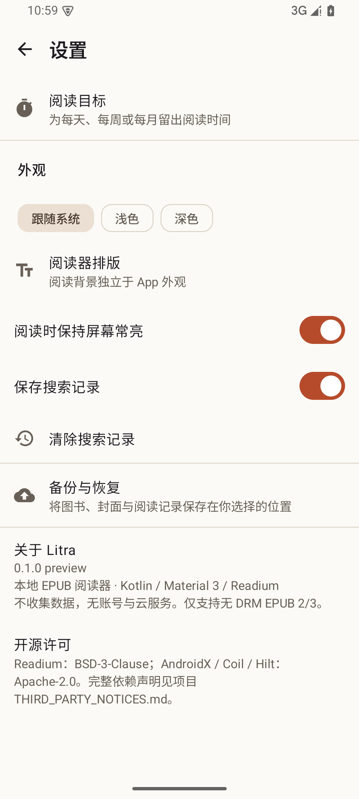
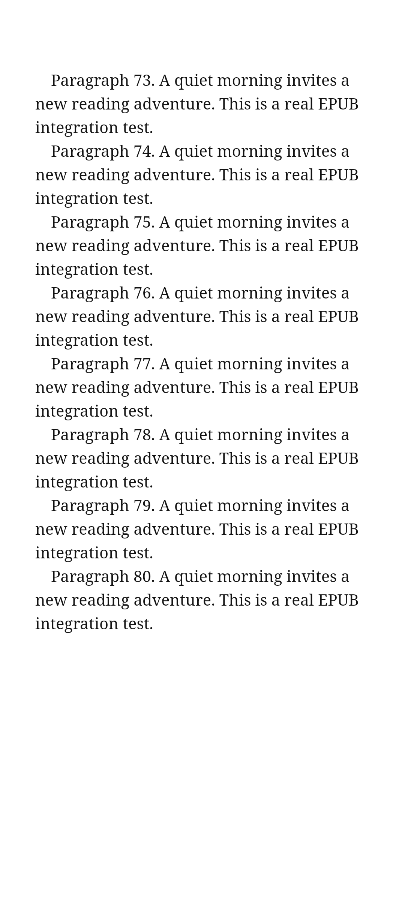
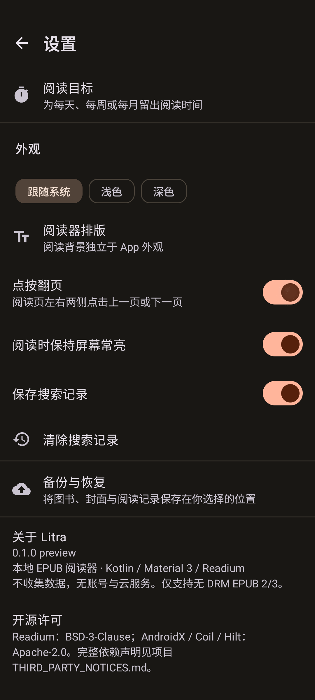

# Litra

[](https://github.com/unfo17/litra-readium/actions/workflows/android.yml)

一个安静、原生的 Android 本地 EPUB 阅读器。Kotlin、Jetpack Compose、Material 3 和 Readium 3.4.0。无账号、无书店、无云同步。

[下载 v0.1.0 preview](https://github.com/unfo17/litra-readium/releases/tag/v0.1.0) · [验收记录](docs/STATUS.md) · [更新记录](CHANGELOG.md)

## 功能

- SAF 多文件导入 EPUB 2/3，私有文件存储、SHA-256 查重、真实元数据和封面。
- 从文件管理器或分享菜单用“打开方式”导入 EPUB；相同文件会打开书库已有条目。
- 双列书库、列表、排序、欲读清单、自定义分类、独立已读完时间线。
- Readium 重排与固定版式 EPUB；目录、正文搜索、书签、完整 Locator 保存/恢复。
- 阅读页中央点按可沉浸阅读；两侧点按翻页可在设置关闭，排版、系统衬线/无衬线、阅读亮度、背景主题均跨书保存。
- 阅读进度最高 99%；不会自动完成。主页 99% 卡片只显示“点击标记读完”；手动完成后，重读仍为已读完。
- 空的继续阅读、欲读、之前读过区块自动隐藏；阅读目标与今年读过保持可见。搜索无历史时不渲染记录区。
- 每天/每周/每月阅读目标，前台计时、周期打卡和历史目标快照。
- SAF 本地备份与恢复，包含 EPUB、封面、分类、书签、进度、目标和搜索记录；按 SHA-256 合并。
- 全出血详情页、图书/漫画类型、设置、深色模式、独立阅读背景、常亮和搜索记录开关。

## 截图

API 35 模拟器实机截图；画面使用本地生成的演示 EPUB，不随应用打包。

   

  

 

## 安装与使用

Android 7.0（API 24）及以上。从 Release 下载 APK 安装，前往书库点“导入”，或从文件管理器选择 Litra 打开本地无 DRM EPUB。长按图书可阅读、加入欲读、手动完成、加入分类或移除。设置中的“备份与恢复”使用系统文件选择器导出或合并 `.litrabackup` 文件。封面与文件复制到应用私有目录，移除前会确认；原始文件保留。

`v0.1.0` 为 **preview / debug signed**，不是正式商店签名。构建机器的 debug 证书可能不同；更换签名的安装包无法直接覆盖安装，卸载会清除应用内书库与进度，请保留原始 EPUB。

## 构建与验证

JDK 17、Android SDK 37.0、Build Tools 36.0.0。通过 `ANDROID_HOME` 或不提交的 `local.properties` 指定 SDK。

```sh
sdkmanager 'platforms;android-37.0' 'build-tools;36.0.0' 'platform-tools'
./gradlew assembleDebug testDebugUnitTest lintDebug assembleRelease
# 启动 Android 模拟器后：
./gradlew connectedDebugAndroidTest
```

本机若遇到 Java 访问 Maven 的 TLS 握手失败，可运行 `python3 tools/build_with_curl.py`；它仅在本次构建期间，通过 curl 校验证书访问同一批官方源并复用本地缓存，不改变项目或 CI 的仓库配置。

技术版本：Kotlin 2.4.20、AGP 9.3.1、Gradle 9.7、compile/target SDK 37、minSdk 24；Room + KSP、Hilt、Coil、DataStore、Navigation Compose。为匹配 Kotlin 2.4 与当前 Hilt/KSP，显式使用 Kotlin Android 插件和 AGP 的兼容 DSL；配置已在本机和 Actions 验证。

本地验证包含 16 项单元测试和 11 项 API 35 设备测试：99%/完成状态、八种主页区块组合、打开方式导入与查重、备份清单/冲突/zip-slip、两本书完整备份往返、中央点按显隐工具栏、真实 EPUB 左右翻页与书首/书末边界、点按翻页设置、Readium 渲染/位置恢复/搜索、固定版式。CI 的 push/PR 执行 debug、单元测试、lint 和 R8 release；当前开发轮不创建新 tag 或 Release，版本仍为 `0.1.0`。

## 架构与数据

单 Activity；Compose + Navigation；ViewModel 单向状态流；Repository 管理 Room、私有 EPUB、Readium Publication 和 DataStore。数据库 schema 位于 `app/schemas`，没有破坏性迁移。文件路径在数据库中相对应用目录保存。

- 阅读状态独立保存 `UNREAD / WANT_TO_READ / READING / FINISHED`，普通进度写入不能覆盖 `FINISHED`。
- 阅读器保存完整 Locator，显示进度单独限制到 99%；退出和进入后台时补存位置。
- 阅读时长仅在导航器可用、前台且没有工具面板时累计，每 15 秒落库，暂停时补记；会话跨本地午夜分段。
- 修改目标在当前周期结束后生效。历史保留当时目标；切换周期后的首个周期可能较短，避免追溯重算。

## 已知限制

- V1 仅支持无 DRM EPUB；PDF/有声书入口显示暂不支持，不导入这些格式。
- 应用不申请网络权限；EPUB 中引用的远程图片、字体或脚本不会加载，仅本地资源可用。
- Readium 3.4.0 Compose 导航器为实验 API；固定版式保留原书排版，字号等重排选项不适用。
- WebView 没有可靠转发中心点按，因此阅读页中央 36% 宽、30% 高的透明区域负责显隐工具栏；该小区域会截获文本选择和链接点按。默认开启的左右 31.8% 全高区域分别用于上一页/下一页，会截获这些区域内的文本选择和链接；可在“设置 → 点按翻页”关闭，只保留中央显隐区域。
- 自定义分类不能使用默认藏书名称。单文件导入上限 512 MB；书内搜索每次最多显示 500 个结果，可缩小关键词范围。
- 异常杀进程可能丢失最后不足 15 秒的阅读计时；正常暂停会补记。目标范围为 1–1440 分钟。
- 设备自动化基于 API 35 ARM64 模拟器；尚未覆盖所有厂商 WebView、低内存真机或全部第三方 EPUB 排版。
- 应用不做云备份；本地备份文件由用户自行保存。卸载应用会删除应用内数据。源码、构建流程与数据库格式开放。

默认分支 `main`；功能分支 `feat/...` + PR；Conventional Commits。整个开发周期只发布 `v0.1.0`，不创建里程碑 tag。

## 开源依赖

[第三方依赖与版权声明](THIRD_PARTY_NOTICES.md)。完整常用许可证与实际字体版权声明随 APK 打包，可在“设置 → 开源许可”查看。使用 Android 系统字体和 Material 图标，不打包 Apple 字体、图标或素材。
